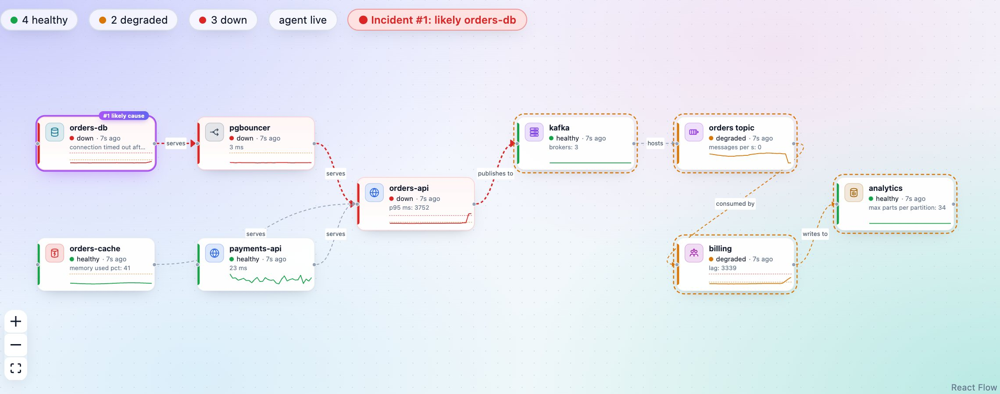
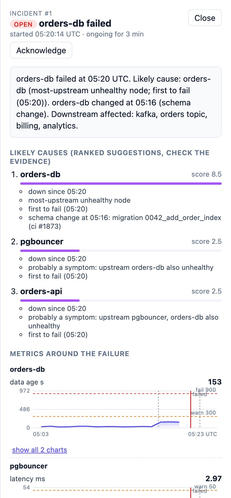

# MDJaada agent

*Jaada* (Urdu/Persian): road, route, pathway. MDJaada follows the path a failure takes through your system back to
where it started.

This is the open-source **agent** of [MDJaada](https://mdjaada.com), drag-and-drop flow observability for data and
service pipelines. You draw your system in MDJaada (databases, Kafka, queues, APIs, Airflow DAGs, ML models), and the
agent runs **inside your network**, checks every node on a schedule, receives your OpenTelemetry spans, logs and
metrics, and keeps that telemetry locally. When something breaks, MDJaada opens one incident, ranks the likely causes
and pulls the matching spans and log lines from the agent as evidence.

The agent's code is public so you can read exactly what runs in your environment and what it sends out.

| Canvas | Incident |
|---|---|
|  |  |

**Try MDJaada:** a 14-day trial at [app.mdjaada.com](https://app.mdjaada.com), or ask for a self-hosted pilot at
[mdjaada.com](https://mdjaada.com). The agent needs an MDJaada account (hosted or self-hosted) to report to.

## What stays in your network

- **Telemetry stays with the agent.** Spans, logs and OTel metric points are stored on the agent host
  (`MDJAADA_RETENTION_HOURS`, default 72) and only queried on demand during an incident.
- **Secrets stay on the agent host.** Write any node setting as `env:VAR_NAME` (for example
  `"password": "env:MYSQL_PASSWORD"`) and the agent reads it from its own environment. See
  [examples/secrets.env.example](examples/secrets.env.example).
- **No inbound access from MDJaada is needed.** The agent connects out to your MDJaada API and to the systems it
  checks; it listens only on port 4318 for your own apps' telemetry. The platform keeps flow config, health status,
  change events and incident summaries.

## Install

**Linux binary as a systemd service** (no Python needed; signed releases in
[mdjaada-releases](https://github.com/madhubolla2205/mdjaada-releases)):

```bash
curl -fsSLO https://github.com/madhubolla2205/mdjaada-releases/releases/latest/download/install.sh
sudo bash install.sh --api https://app.mdjaada.com/api --agent-id dc1-agent --assigned-only
```

**Docker:** `docker run -e MDJAADA_API=... -e MDJAADA_API_KEY=... -p 4318:4318 madhubolla/mdjaada:agent-<version>`,
or build your own with `docker build agent` (add `--build-arg WITH_AWS=true`, `WITH_GCP`, `WITH_AZURE`,
`WITH_SNOWFLAKE` for the cloud connectors).

**Kubernetes:** [deploy/kubernetes/agent.yaml](deploy/kubernetes/agent.yaml) (read-only RBAC, non-root, read-only
filesystem).

**From source:** Python 3.10+, standard library only for the core: `python agent/agent.py`. Database drivers are
optional (`psycopg`, `PyMySQL`, `pymongo`, `confluent-kafka`, `PyYAML`). Systemd details are in
[deploy/systemd/README.md](deploy/systemd/README.md).

## What it checks

Every node accepts the generic checks (`host`+`port` TCP, `health_url`, `metrics_url`+`metric`) plus:

| Area | Node types |
|---|---|
| Services | HTTP service, proxy, custom (SQL, Prometheus metric, URL or port) |
| Databases and stores | Postgres, MySQL / MariaDB, ClickHouse, Snowflake, MongoDB, Redis, Elasticsearch / OpenSearch |
| Streams and queues | Kafka cluster / topic / consumer group, RabbitMQ cluster / queue, AWS SQS, Google Pub/Sub |
| Pipelines and ML | Airflow DAG (2.x and 3.x), MLflow model |
| Platforms | Kubernetes workloads (rollouts recorded as deploy events), AWS CloudWatch, Azure Monitor |

Queues and streams work as layers: the agent discovers each cluster's topics, consumer groups and queues and
suggests them in MDJaada, so a missing broker, a topic nothing is produced to and a stalled consumer are each reported
on the right node. A missing driver shows the node as *degraded: install …*, never as down.

## Sending spans, logs and metrics

The agent's receiver speaks **OTLP/HTTP with JSON encoding** on port 4318 (`/v1/traces`, `/v1/logs`, `/v1/metrics`):

```bash
OTEL_EXPORTER_OTLP_ENDPOINT=http://<agent-host>:4318
OTEL_EXPORTER_OTLP_PROTOCOL=http/json
OTEL_SERVICE_NAME=orders-api        # match the node name or the node's `service` setting
```

For gRPC/protobuf sources, put an OpenTelemetry Collector in front:
[deploy/monitoring/otel-collector.yaml](deploy/monitoring/otel-collector.yaml).

All error spans and spans slower than `MDJAADA_SLOW_SPAN_MS` are kept; healthy spans are sampled per trace at
`MDJAADA_HEALTHY_SAMPLE_RATE`.

## Configuration

`MDJAADA_API`, `MDJAADA_API_KEY`, `MDJAADA_FLOW_ID` or `MDJAADA_FLOW_NAME`, `MDJAADA_AGENT_ID`,
`MDJAADA_ASSIGNED_ONLY`, `MDJAADA_INTERVAL` (30), `MDJAADA_TASK_POLL` (5), `MDJAADA_OTLP_PORT` (4318, `0` disables),
`MDJAADA_DATA_DIR`, `MDJAADA_RETENTION_HOURS` (72), `MDJAADA_METRICS_RETENTION_HOURS` (6), `MDJAADA_BUFFER_MB` (50),
`MDJAADA_SLOW_SPAN_MS` (500), `MDJAADA_HEALTHY_SAMPLE_RATE` (0.1), `MDJAADA_CHECK_TIMEOUT` (5),
`MDJAADA_K8S_DISCOVERY`, `MDJAADA_K8S_NAMESPACES`.

## Development

```bash
pip install pytest pyyaml
pytest -q agent/tests
```

Issues and pull requests are welcome.

## Licence

The agent is licensed under the [Apache License 2.0](LICENSE). The MDJaada platform (API, web app and hosted service)
is not part of this repository and is not open source.
